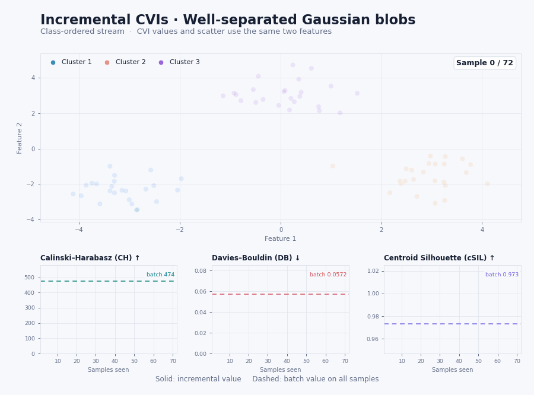
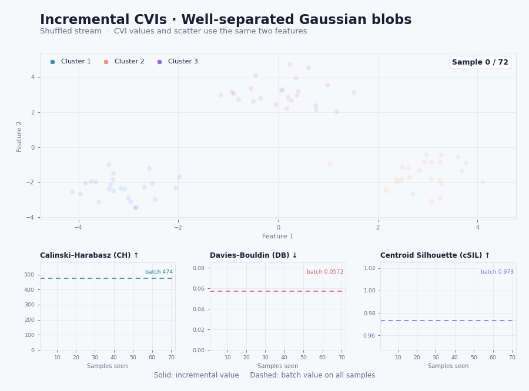
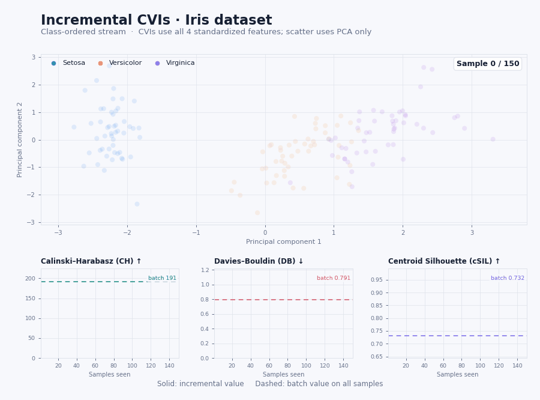

Batch and Incremental Evaluation
================================

Every index in ``cvi`` can be computed two ways. A **batch** calculation reads a
complete labeled dataset and computes the score in one pass. An **incremental**
calculation keeps a small set of per-cluster statistics (counts, centroids,
spreads, and for some indices pairwise terms) and updates them as each sample
arrives, so the score is always current without revisiting earlier samples.

Both use the same object and the same method: ``get_cvi(samples, labels)`` with
a two-dimensional array is a batch call, and ``get_cvi(sample, label)`` with one
sample is an incremental update. A batch call leaves the object holding the same
statistics an incremental run would have built, so you can start with a batch
and continue incrementally.

The same result either way
--------------------------

For every index except ``CONN``, the incremental update is an exact
rearrangement of the batch formula, so both reach the same score for the same
partition. Results can differ only by floating-point rounding, because the
operations happen in a different order. ``CONN`` also learns prototypes, and its
batch KMeans backends are different models from its incremental FuzzyART
backend; see :doc:`conn`.

The animations below track CH, DB, and cSIL as labeled samples arrive. Faded
points have not arrived yet. Solid traces are the incremental values and dashed
lines are the batch value for the complete dataset. Each dataset is streamed in
class order and then in a fixed random order; the Iris CVIs use all four
standardized features, with PCA only for plotting.

.. image:: _static/readme/incremental-cvi-iris-shuffled.gif
   :alt: Incremental CVIs on the shuffled Iris dataset
   :width: 49%

Trade-offs
----------

.. list-table::
   :header-rows: 1
   :widths: 18 41 41

   * -
     - Batch
     - Incremental
   * - Scores
     - One score for the complete dataset.
     - A score after every sample, so you can follow how the partition evolves.
   * - Cost
     - One vectorized pass over all samples. Fastest way to score data you
       already have.
     - Each update costs work proportional to the number of clusters and
       features, not the number of samples seen. Scoring a whole dataset this
       way is slower than one batch call because of per-call overhead.
   * - Memory
     - The full dataset must be in memory for the call.
     - Only per-cluster statistics are kept. Pairwise indices also store a
       cluster-by-cluster matrix, and ``rCIP`` stores a covariance per cluster.
   * - Changing the partition
     - Re-score from scratch after any change.
     - Remove, move, merge, and split update the statistics in place, and
       ``commit=False`` scores a change without applying it. See
       :doc:`operations`.

Because a batch call leaves the same statistics behind, a batch-initialized
object gets every incremental capability too.

``update_batch`` sits between the two: it adds a chunk of samples to the
existing statistics in one vectorized step and returns the score for
everything seen so far. Use it for streams that arrive in blocks when you do not
need a score after every sample. See :doc:`operations`.

Which to use
------------

* **Scoring finished clusterings**, such as comparing results from several
  algorithms or settings: batch.
* **Monitoring a clustering stream**, or watching how an online algorithm's
  partition develops: incremental.
* **Building or refining a partition**, where you try assigning a sample to
  different clusters or merging clusters and keep the best result: incremental,
  using trial scoring and moves.
* **Large datasets that do not fit in memory**, or data that arrive in blocks:
  ``update_batch``.

See :ref:`benchmarks` for measured batch and incremental timings.
